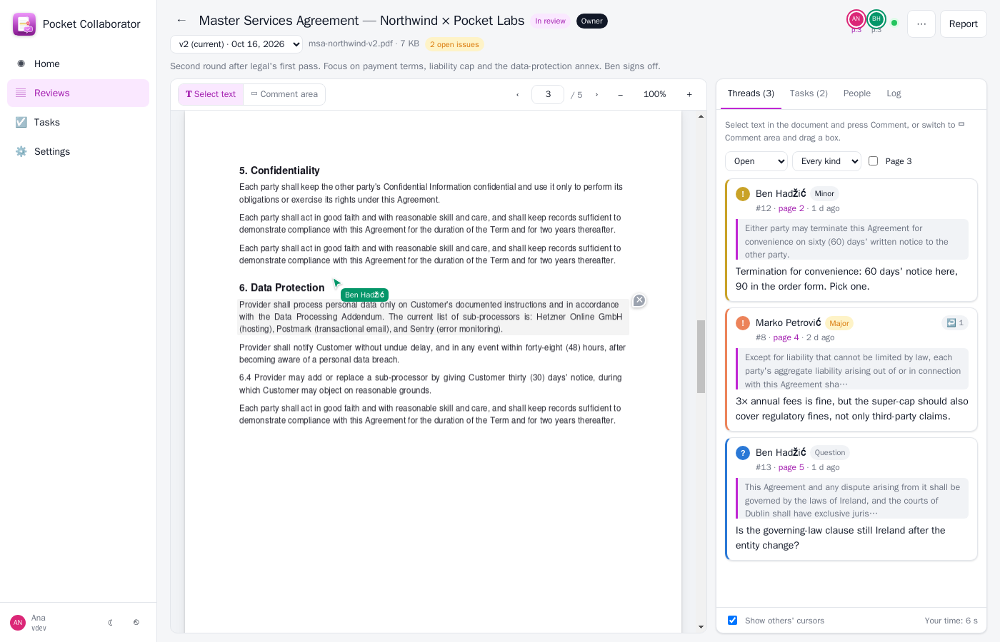
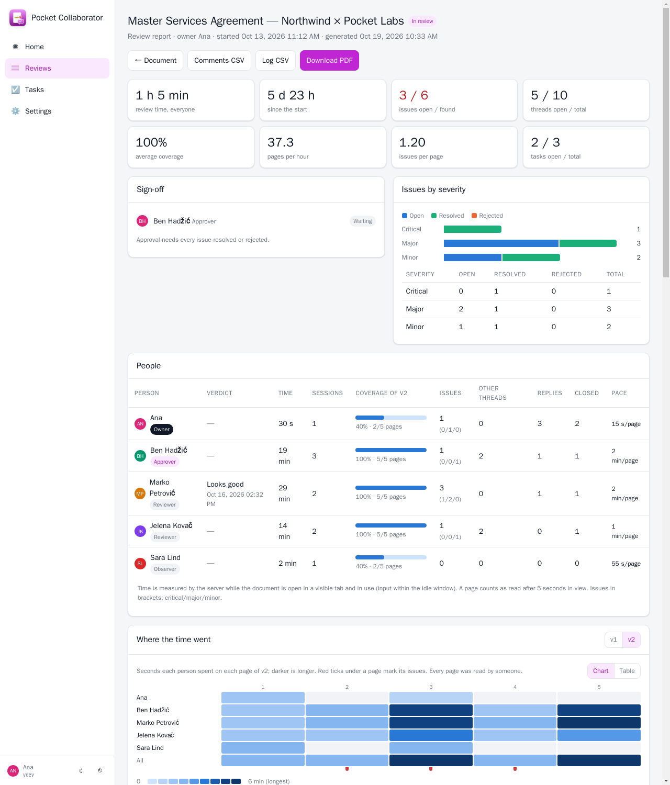
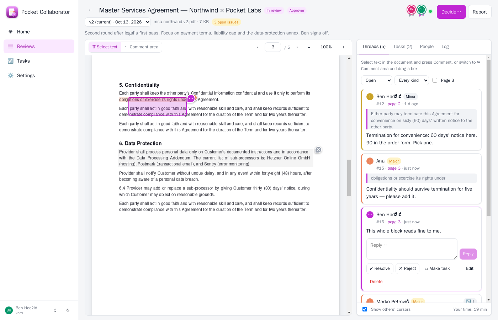
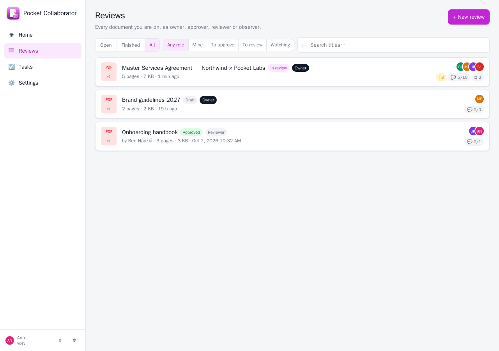
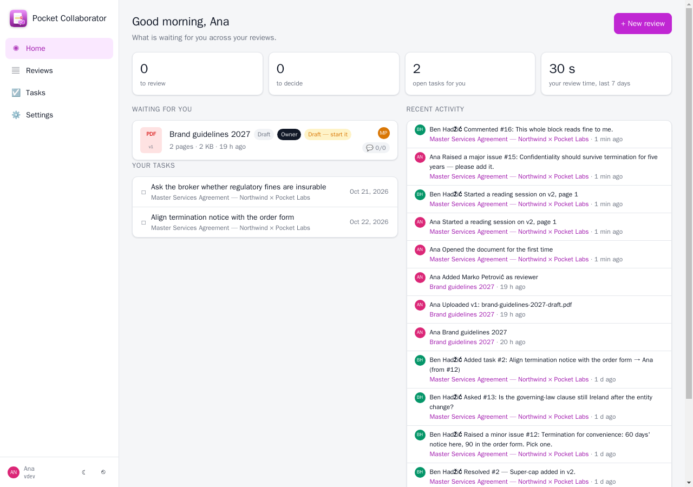

<p align="center">
  
</p>
<h1 align="center">Pocket Collaborator</h1>
<p align="center">
  Review a document together: comments pinned to the page, issues that get resolved or rejected, tasks, a strict sign-off, live presence, and a report of who spent how long on what.<br>
  <b>One binary · one SQLite file plus the documents · one volume.</b>
</p>
<p align="center">
  <a href="https://github.com/abjelosevic88/pocket-homelab-collaborator/actions"></a>
  <a href="https://github.com/abjelosevic88/pocket-homelab-collaborator/pkgs/container/pocket-homelab-collaborator"></a>
  <a href="LICENSE"></a>
</p>

---

Peer review tools like SmartBear Collaborator are built for enterprises and priced that way. This is the same core idea, small enough for a home server or a small team. It starts with PDFs, and the model is ready for other sources.

- **One review per document.** The owner uploads a PDF and puts people on it as **approver** (the strict sign-off), **reviewer** or **observer**. Anyone not on the review gets a 404, admins included.
- **Comments that point at something.** Select text and press *Comment*, or draw a box on the page. A thread is a **comment**, a **question** or an **issue** (minor / major / critical) with replies. Threads are **resolved** or **rejected** (rejecting needs a reason), and can be reopened.
- **Tasks.** Turn any thread into a task with an assignee and a due date, or add one directly. *Tasks* lists everything assigned to you across reviews.
- **Revisions.** Upload v2, v3…: open threads carry over, everyone's verdict is cleared so they look again, and older revisions stay viewable with their own threads.
- **A real decision.** Reviewers finish with *looks good / needs changes / reject*. Approvers decide: **approve** (blocked while any issue is still open, unless you turn that rule off), **request changes** or **reject**. With several approvers, every one of them has to approve.
- **Everything is logged.** Created, invited, opened, uploaded, commented, replied, resolved, rejected, reopened, task added or done, verdicts, decisions, reading sessions. The log is append-only, filterable, and downloadable as CSV.
- **Review time that means something.** The server keeps the clock, not the browser. Time counts only while the document is open in a visible tab *and* the person did something (scroll, mouse, keys, zoom) recently. Several tabs count once, and the time is credited to the page in view. That gives per-person totals, reading sessions, page coverage, and a page-by-page attention map.
- **Live.** See who has the document open, on which page, active or idle; click someone to jump to their page; watch their cursor if you want. New comments, replies, state changes and tasks appear on everyone's screen as they happen.
- **The report.** Sign-off; per-person time, sessions, coverage, issues found, replies, closed threads and pace; issues by severity and state; *where the time went* (people × pages heatmap, with the pages nobody read called out); sessions on a timeline; open issues; tasks; every thread; the full log. Inspection rate (pages/hour) and defect density (issues/page) come from the same numbers. The PDF version is the record you file.

<p align="center"></p>

<table>
  <tr>
    <td width="50%"></td>
    <td width="50%"></td>
  </tr>
  <tr>
    <td align="center"><sub>The report: who looked at what, for how long, and what they found.</sub></td>
    <td align="center"><sub>Two people on the same page: an issue from a text selection, an area comment.</sub></td>
  </tr>
  <tr>
    <td width="50%"></td>
    <td width="50%"></td>
  </tr>
  <tr>
    <td align="center"><sub>Every review you are on.</sub></td>
    <td align="center"><sub>Home: what is waiting for you.</sub></td>
  </tr>
</table>

## Quick start

```sh
docker run -d --name pocket-collaborator -p 8080:8080 -v ./data:/data ghcr.io/abjelosevic88/pocket-homelab-collaborator:latest
```

Open http://localhost:8080 and create the first account (it becomes the admin). Behind HTTPS set `BASE_URL` and `SECURE_COOKIES=true`. The live channel is a WebSocket on `/api/v1/reviews/{id}/live`; Caddy, Traefik and nginx with the usual upgrade headers pass it through (see [docs/reverse-proxy.md](docs/reverse-proxy.md)).

Try it with sample data and no login:

```sh
make web build && DATA_DIR=./data DEMO_DATA=true AUTH_MODE=none ./pocket-collaborator
```

## How a review goes

1. **Owner:** *New review* → drop the PDF, add an approver and reviewers (pick an account or type an email; unknown emails get an account that signs in with single sign-on, or an admin sets a password). The review starts as a **draft**.
2. **Owner:** *Start review*. Everyone on it sees it under *Home → Waiting for you*.
3. **Reviewers:** read, select text or draw boxes, raise issues, ask questions, reply. *Finish review* with a verdict.
4. **Owner / approvers:** resolve or reject threads, turn them into tasks. Approvers *Decide*:
   - **Request changes** → the owner uploads v2 → the review is back in review, verdicts are cleared, open threads carry over.
   - **Approve** → refused while issues are open (if the rule is on); otherwise approved once every approver approves.
   - **Reject** → ends the review.
5. Anyone on it opens **Report** → *Download PDF*.

Roles in detail:

| | Owner | Approver | Reviewer | Observer |
|---|:-:|:-:|:-:|:-:|
| Read, see the log and the report | ✓ | ✓ | ✓ | ✓ |
| Comment, raise issues, reply, add tasks | ✓ | ✓ | ✓ | |
| Resolve / reject **any** thread | ✓ | ✓ | own threads | |
| Verdict | decides when there is no approver | **decides** | finishes | |
| Upload revisions, manage people, start / cancel / reopen, delete | ✓ | | | |

## Pocket Core

With `CORE_URL` set the app registers with [Pocket Core](https://github.com/abjelosevic88/pocket-homelab-core), offers **Sign in with Pocket Core**, accepts the tokens Core hands to paired phones, and publishes `collaborator.review_started`, `collaborator.comment_added` and `collaborator.review_decided` (each with `audience_emails`, the people on the review). Without it everything works the same.

## Documentation

- [Configuration](docs/configuration.md): every environment variable
- [How review time is measured](docs/review-time.md): the clock, sessions, coverage, the report's numbers
- [API](docs/api.md): JSON API, tokens, the live channel
- [Reverse proxy](docs/reverse-proxy.md) · [Backup](docs/backup.md) · [Roadmap](docs/roadmap.md)

## Build

Go 1.26 and Node 22.

```sh
make web build     # UI into web/dist, then a static binary that embeds it
make test          # go vet + go test + tsc
make docker
```

PDF rendering is Mozilla [pdf.js](https://mozilla.github.io/pdf.js/) (legacy build, so older iPhones work too); report PDFs are drawn with [go-pdf/fpdf](https://github.com/go-pdf/fpdf) and DejaVu Sans.

## License

MIT
